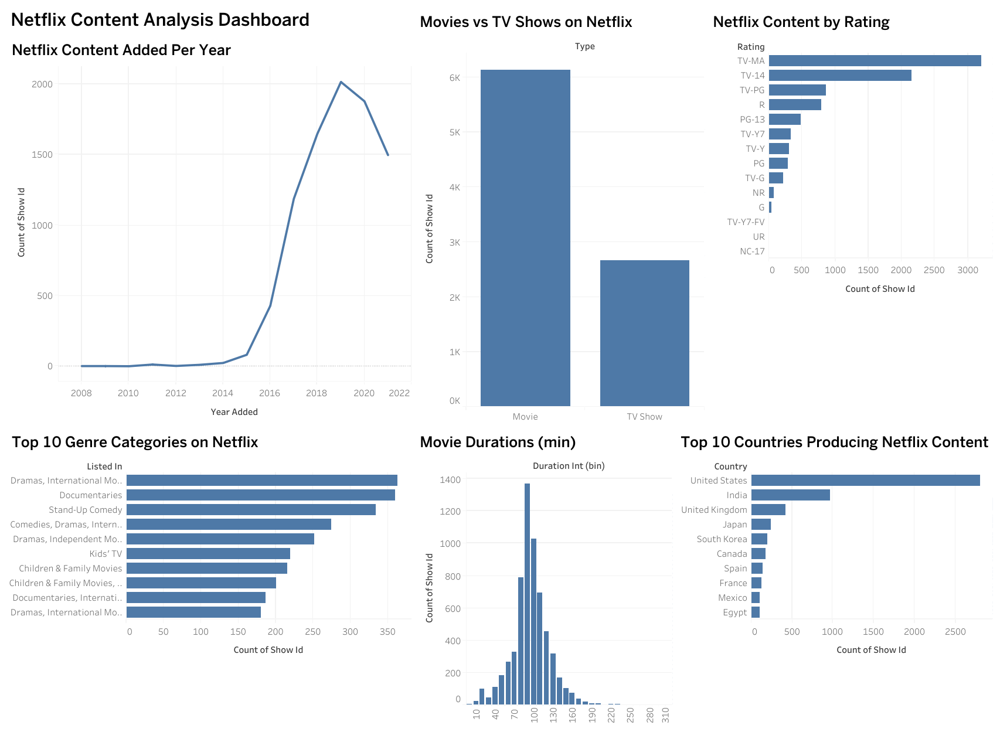

# Netflix Data Visualization — CodeAlpha Internship Task 3

An interactive dashboard built in Tableau using the Netflix Movies & TV Shows dataset.

## Live Dashboard
Tableau Public: https://public.tableau.com/app/profile/aashish.kumar8547/viz/Netflix_Content_Analysis_17914380442320/Netflix_Dashboard

## Dashboard Preview

## Charts Included
- Movies vs TV Shows
- Content added per year
- Top 10 countries
- Content by rating
- Movie duration distribution
- Top 10 genre categories

## Key Insights
- Movies make up ~70% of the catalog
- Content additions peaked in 2019 (2021 data is partial, up to Sept)
- US and India are the top content-producing countries
- TV-MA is the most common rating
- Most movies run between 90-120 minutes

## Notes
- 3 rows with invalid rating values (e.g. "84 min") were excluded from the rating chart
- Genre chart counts each genre combination as one category

## Tools
Tableau Public